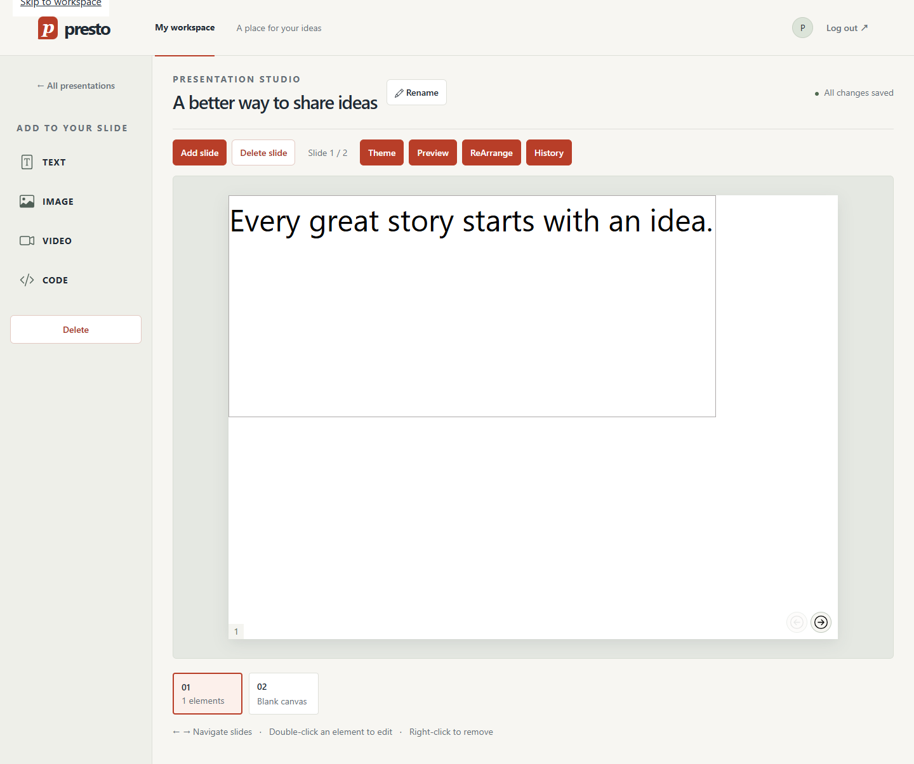

# Presto — Presentation Studio

Create, edit and present slide decks in a React workspace backed by an Express API.

Maintained by **Weihou Zeng (PeterZG)**.



## Features

- Account registration, login and logout.
- Searchable presentation library.
- Create, rename, update thumbnails and delete presentations.
- Add, remove and reorder slides.
- Text, image, video and syntax-highlighted code elements.
- Element positioning, resizing and slide themes.
- Presentation preview, keyboard navigation and recent version history.

## Technology

React 18, React Router, React Bootstrap and Highlight.js on the frontend; Express, JWT and JSON-file persistence on the backend.

## Project structure

```text
frontend/src/
  pages/          Login, registration, library, editor and preview
  layout/         Shared authentication and dashboard layouts
  editor/         Canvas, element editing, themes, ordering and history
  services/       API requests and presentation storage
  state/          Shared message state
  ui/             Reusable controls and dialogs
  tests/          Frontend tests
backend/
  src/server.js               HTTP routes
  src/presentationService.js  Accounts, sessions and presentation data
  src/apiErrors.js            Request error types
  test/                       Backend tests
docs/screenshots/             Interface screenshots
```

## Run locally

Use Node.js 22+ and npm. Start the API first:

```sh
cd backend
npm ci
npm start
```

Then start the frontend in another terminal:

```sh
cd frontend
npm ci
npm start
```

Open `http://localhost:3000`. The API listens on `127.0.0.1:5005`; its endpoint documentation is at `http://localhost:5005/docs/`.

## Using the editor

Register an account, sign in and choose **New presentation**. Open a deck, add slide elements from the tool rail and use the filmstrip to change slides.

Double-click an element to edit it. Use the selection controls to adjust its position and size. The left/right arrow keys change slides when focus is outside a form field. **Preview** opens the presentation in a separate tab.

Press Enter on an element to open the same editing dialog with precise position and size fields. On narrow screens, use **Canvas zoom** to enlarge the authored slide and pan within the stage; **Fit to screen** restores the responsive view. Arrangement supports both dragging and labelled move buttons.

Recent history retains up to 100 independent snapshots from the last 24 hours in browser storage. Restoring a snapshot saves it back to the API. It is an editing aid, not a durable backup.

## Configuration

| Setting | Purpose | Default |
| --- | --- | --- |
| `REACT_APP_API_BASE_URL` | Frontend API address | `http://localhost:5005` |
| `HOST` / `PORT` | Backend listening address | `127.0.0.1:5005` |
| `PRESTO_DATABASE_FILE` | Backend JSON data file | `database.json` |
| `JWT_SECRET` | Private signing key, at least 32 characters | Random process key |

Set environment variables before starting the relevant process. A `.env.example` file is a reference, not an automatically loaded backend configuration.

When `JWT_SECRET` is omitted, restarting the API invalidates existing tokens. Passwords use salted scrypt hashes; a successful login upgrades an older plaintext account. Tokens expire after eight hours and are invalidated by logout or a later login.

Account and presentation changes are written atomically before the API reports success. A failed disk write keeps the previous saved state and session usable. Reads do not rewrite the database. In the editor, queued writes retain their originating account; damaged or full local history does not block saving to the API.

## Tests and build

```sh
# backend
npm run lint
npm test -- --runInBand

# frontend
npm run lint
npm test -- --watchAll=false
npm run build
npm run qa:browser
npm run qa:native-zoom
```

The browser check starts its own API with an isolated database under ignored `.qa/` and stops it afterward. Build for its API address first (PowerShell):

```powershell
$env:REACT_APP_API_BASE_URL='http://127.0.0.1:5187'
npm run build
$env:BROWSER_CHANNEL='chrome'
npm run qa:browser
```

Use `QA_API_URL` and `QA_PORT` to select free API and frontend ports. `REACT_APP_API_BASE_URL` must match `QA_API_URL`. The checks exercise persisted deck, slide and element CRUD, title/thumbnail, themes, pointer move/resize, ordering, history restore, preview, session invalidation, recovery, long text, six viewport widths and 200% enlargement. Images use an inline fixture; video CRUD verifies the saved embed and the local player frame, while external YouTube delivery depends on the provider/network.

`qa:browser` checks CSS page enlargement, UI text enlargement and canvas zoom. `qa:native-zoom` separately sets actual browser zoom to 200% in an automatically removed temporary profile, with viewport emulation disabled. It checks registration, login, dashboard, editor and preview, plus persisted CRUD, element dragging/resizing, navigation and dialogs. Native screenshots use full-content CDP capture. This command requires installed Chrome or Edge and defaults to frontend port 4174.

The production frontend is written to `frontend/build/`.

Interface checks enforce a 16px minimum and contrast ratios for ordinary UI text, plus reflow at six widths. Authored slide content keeps its chosen size and colours; text over artwork also needs screenshot review. Native zoom defaults to installed Chrome; `BROWSER_CHANNEL=msedge` selects Edge. The GitHub workflow runs lint, unit tests, builds and both browser checks, saving screenshots. It does not deploy the application; confirm remote Actions conclusions separately from local results.

## Limitations

The backend is a single-process local service with JSON persistence. It does not provide managed account recovery, multi-instance storage or production rate limiting. Browser tokens are stored in localStorage. A public deployment needs appropriate authentication, storage and dependency hardening.

[中文说明](README_zh.md) · [Code guide](CODE_GUIDE.md) · [Frontend setup](frontend/README.md)
